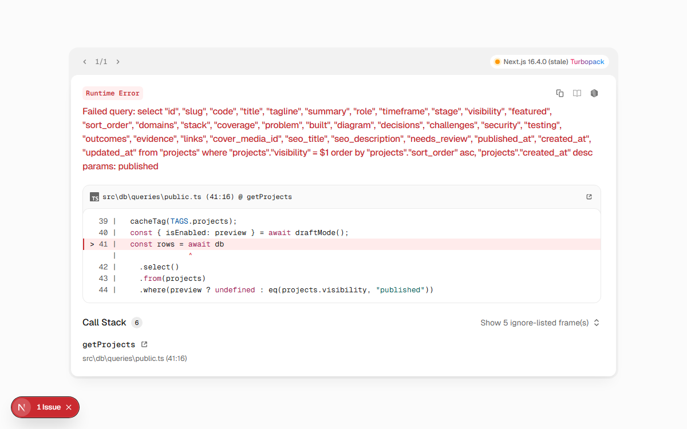
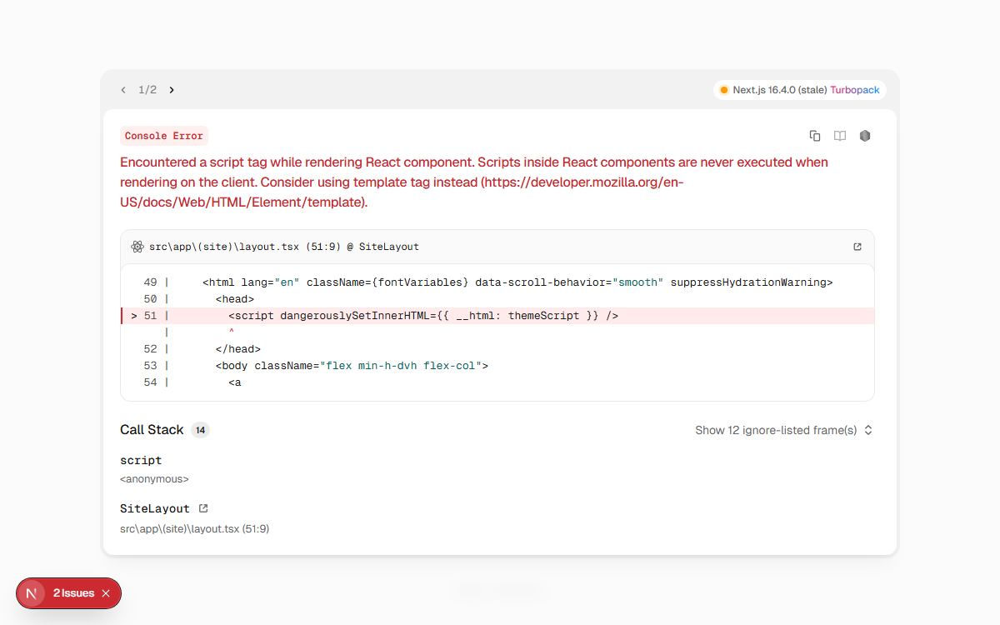

# Hey there, I'm Abiram Krishn 👋

  
  
  

 

<!-- ==========================================
     1. ANIMATED CONTRIBUTION HEATMAP (Auto-Refreshed Daily)
     ========================================== -->
<h3><code>abi@github ~ $ ./contributions.sh</code></h3>

 
 

<!-- ==========================================
     2. DUAL-PANE TERMINAL: PRODUCTION SYSTEMS + TELEMETRY CARD
     ========================================== -->
<h3><code>abi@github ~ $ whoami</code></h3>

<table>
<tr>
<td valign="top" width="50%"></td>
<td valign="top" width="50%"></td>
</tr>
</table>

 
 

<!-- ==========================================
     3. VISUAL WORK SHOWCASE (SCREENSHOT GALLERY)
     ========================================== -->
<h3><code>abi@github ~ $ ./projects.sh --visual-gallery</code></h3>

<table>
<tr>
<td width="50%" align="center" valign="top">
  <a href="https://portfolio-abiram1.vercel.app/work/vaakku-ai">
     
    <b>🎙️ Vaakku AI: Speech-to-Speech Platform</b>
  </a>
  
<small>Gemini Live voice agents in Malayalam/English, modular monolith (api, voice, worker), 20ms audio loop &amp; RLS multi-tenant security.</small>

</td>
<td width="50%" align="center" valign="top">
  <a href="https://cakee.in">
     
    <b>🎂 Cakee.in: Live E-Commerce &amp; Kitchen PWA</b>
  </a>
  
<small>Production bakery storefront with geospatial distance fee pricing, server-verified Razorpay payments, and offline-ready operations PWA.</small>

</td>
</tr>
<tr>
<td width="50%" align="center" valign="top">
  <a href="https://portfolio-abiram1.vercel.app/work/flowbitly">
     
    <b>🏢 Flowbitly: Workforce Operations SaaS</b>
  </a>
  
<small>Multi-tenant workforce platform with organisation-scoped RLS policies, real-time presence/chat, worker task boards &amp; attendance.</small>

</td>
<td width="50%" align="center" valign="top">
  <a href="https://portfolio-abiram1.vercel.app">
     
    <b>⚡ Next.js 15 Interactive Engineering Portfolio</b>
  </a>
  
<small>Next.js 15 App Router, TypeScript, Tailwind CSS, live systems catalog, architectural decisions, and production verification logs.</small>

</td>
</tr>
</table>

 
 

<!-- ==========================================
     4. TECH STACK BADGES (THE TERMINAL ENV)
     ========================================== -->
<h3><code>abi@github ~ $ cat /etc/skills.json</code></h3>

  <!-- Frontend -->
  
  
  
  
  

  <!-- Backend & AI -->
  
  
  
  
  

  <!-- Database, DevOps & Security -->
  
  
  
  
  

 

<code>[Process completed with exit code 0]</code>

Designed & engineered by <a href="https://portfolio-abiram1.vercel.app">Abiram Krishn</a> • Kerala, India

