# Hey there, I'm Abiram Krishn 👋

  
  

 

<!-- ==========================================
     1. ANIMATED CONTRIBUTION HEATMAP (Auto-Refreshed Daily)
     ========================================== -->
<h3><code>abi@github ~ $ ./contributions.sh</code></h3>

 
 

<!-- ==========================================
     2. DUAL-PANE TERMINAL: PRODUCTION SYSTEMS + TELEMETRY CARD
     ========================================== -->
<h3><code>abi@github ~ $ whoami</code></h3>

<table>
<tr>
<td valign="top" width="50%"></td>
<td valign="top" width="50%"></td>
</tr>
</table>

 
 

<!-- ==========================================
     3. PRODUCTION SYSTEMS CATALOG
     ========================================== -->
<h3><code>abi@github ~ $ ./projects.sh --production</code></h3>

| System | Role & Focus | Architecture & Engineering Highlights |
| :--- | :--- | :--- |
| **[Vaakku AI](https://portfolio-abiram1.vercel.app)** | Architecture & AI Engine | Malayalam/English voice agents on Gemini Live speech-to-speech. Modular monolith (`api`, `voice`, `worker`), 20ms audio loop, RLS isolation, Redis/BullMQ. |
| **[Cakee.in](https://cakee.in)** | Full-Stack Commerce | Live bakery storefront with OTP auth, geospatial distance-based pricing, server-verified Razorpay payments, and kitchen operations PWA. |
| **[Flowbitly](https://portfolio-abiram1.vercel.app)** | Co-Developer & Security | Multi-tenant project & workforce management platform. Row-Level Security (RLS) data isolation, real-time presence/chat, worker task boards. |
| **[RBMS 24-Building](https://portfolio-abiram1.vercel.app)** | Prototype & SRS | Bilingual (English/Arabic) commercial property management system for 24 UAE buildings, lease contracts, rent collection, and expense tracking. |

 

<!-- ==========================================
     4. TECH STACK BADGES (THE TERMINAL ENV)
     ========================================== -->
<h3><code>abi@github ~ $ cat /etc/skills.json</code></h3>

  <!-- Frontend -->
  
  
  
  
  

  <!-- Backend & AI -->
  
  
  
  
  

  <!-- Database, DevOps & Security -->
  
  
  
  
  

 

<code>[Process completed with exit code 0]</code>

Designed & engineered by <a href="https://portfolio-abiram1.vercel.app">Abiram Krishn</a> • Kerala, India

